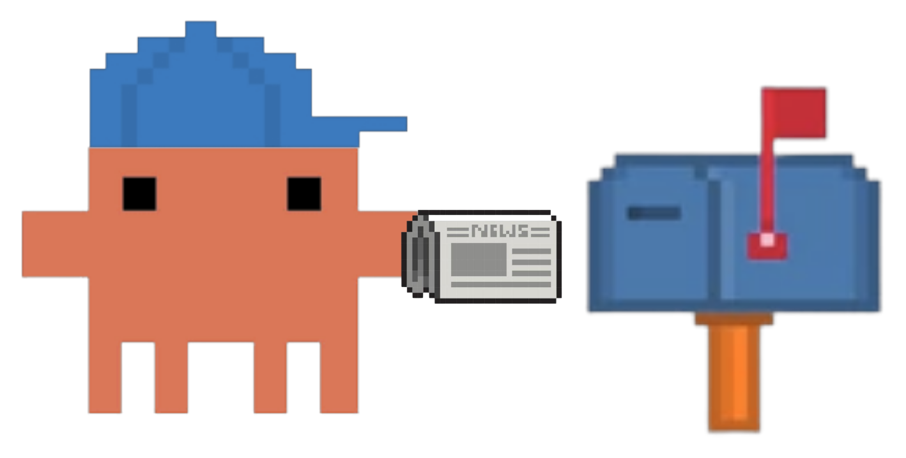
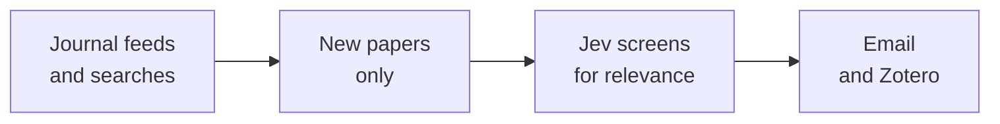

<div align="center">

<h1>Paper Round</h1>
<p><em>New journal papers that match your research, in your inbox every morning.</em></p>
</div>

<p align="center"></p>

Each morning Paper Round reads every new paper in the journals you follow, keeps the ones that fit your research,
and emails them to you. Every paper comes with the sentence from its abstract that shows why it was kept, and kept papers
can go straight into Zotero too. I built it for my own PhD; anyone can run a copy.

## How it works



You describe your research in `scope.yaml`. [Jev](https://typesafe.ai) screens each new paper against it, and the
code keeps the ones that pass. The reason line is copied from the abstract, so nothing in the email
is made up.

## Setup

You need a GitHub account, a Jev key ([typesafe.ai](https://typesafe.ai)) and a free Resend key
([resend.com](https://resend.com)) for the email.

```bash
pip install "paper-round @ git+https://github.com/LaineyLouiseWard/paper-round@v2.0.1"
mkdir my-paper-round && cd my-paper-round && git init
paperround init
```

1. Edit `config.yaml` (journals, email, Zotero) and `scope.yaml` (your questions). The comments in each file say what goes where.
2. Run `paperround run --dry-run` to see which papers it finds.
3. Push to a private GitHub repo and add your keys under Settings → Secrets and variables → Actions:
   `TYPESAFE_API_KEY`, `RESEND_API_KEY`, and optionally `ZOTERO_API_KEY`.
4. Press Run on the Actions tab. From then on it runs every morning.

## Tuning

Open your repo in an AI coding assistant (Claude Code, Codex, Cursor) and tell it what came through that shouldn't
have, or what it missed. `paperround init` writes an `AGENTS.md` that tells the assistant how to adjust `scope.yaml`
and test the change against your past rounds.

## Cost

Jev costs about a cent a day for 70 papers. A round takes a minute or two, well inside GitHub's free Actions minutes.

## Licence

MIT
